# AAO Editor

**[English](./README.en.md)** · 简体中文

**AAO Editor**（全称 **Advanced Arrangement Organizer**）是一款为 BanG Dream 自制谱作者打造的桌面级谱面编辑器。从新建工程、编辑谱面、预览试听，到导出谱面图和游戏实录视频——制谱的每一步都在一个应用里完成。


---

## 下载

桌面安装包见 **[GitHub Releases](https://github.com/wuqiongjin/AAO-Editor/releases)**（Windows NSIS / macOS DMG / Linux AppImage，由 electron-builder 打包）；国内网络也可从 **[CNB Releases](https://cnb.cool/AsterPicker/AAO-Editor/-/releases)** 下载同一批安装包（发布后自动同步，略晚于 GitHub）。若应用内检查更新打不开 GitHub，可先从 CNB 手装一次，再在设置 → 关于里把**下载源**改为 CNB。

安装包暂未做代码签名：macOS 首次打开请右键（或按住 Ctrl 点按）选「打开」；Windows 若弹出 SmartScreen 提示，点「仍要运行」即可。

本应用为非营利粉丝自制工具，安装包内含 BanG Dream! 相关游戏素材。使用前请阅读 [非官方声明](#非官方声明) 中的版权与免责说明。

## 功能特性

### 谱面工程管理：一首歌，一个工程

一个**谱面工程**就是一首歌：工程信息、音频、封面与多张谱面（各带难度 / 等级）集中保存。关闭应用后再打开，会先回到上方的**工程启动台**，继续上次未完成的工程。

**工程启动台**

- **继续创作**：近期工程列表，点进即回到该曲目的工程详情。
- **新建工程**按谱面来源分四路：**空白新建**、**复制工程**、**从官方谱面导入**、**从社区谱面导入**。复制工程不会带上原工程的上传记录，适合拿旧曲当模板、与再次发布互不干扰。

**工程详情**

- 进入某首歌后，在同一页管理多份谱面（难度 / 等级）、查看封面与音频，并从这里进入各谱面的**工作台**。
- **谱面状态**自动派生为未完成 / 已完成 / 已上传；已上传谱面只读，要改请先复制副本再编辑。

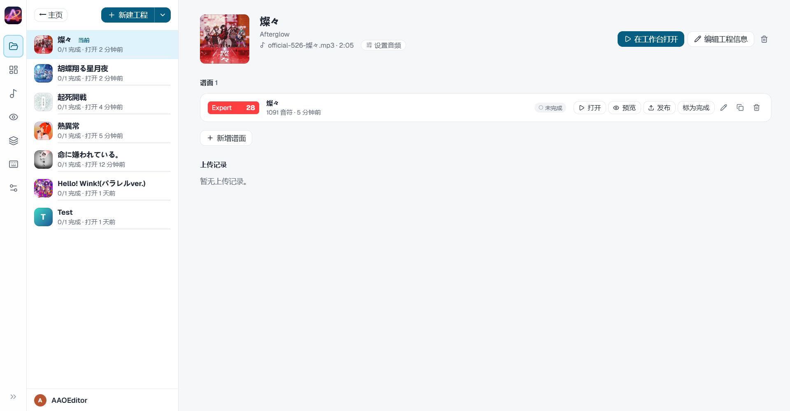

**从曲库创建工程（官方谱面导入示例）**

- 在启动台选「从官方谱面导入」或「从社区谱面导入」，可搜索、试听，再按难度一步建工程——BGM、封面与谱面代码会写入新工程（下图以官方曲库为例；社区入口从帖子拉取，落盘方式相同）。

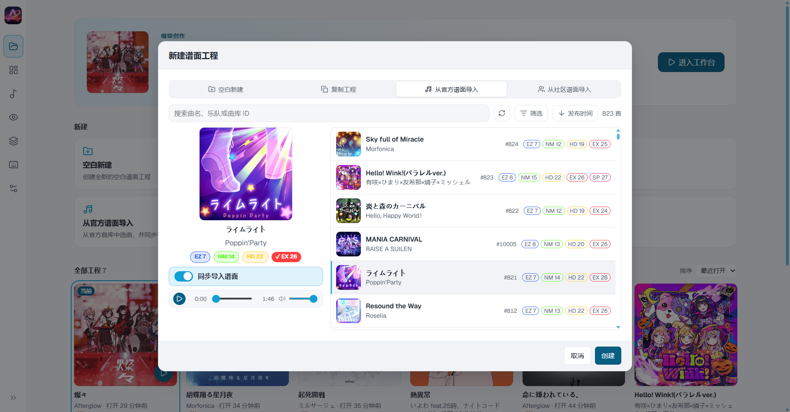

### 专业谱面编辑

- **完整键型**：单键 / 滑键 / 技能键 / 方向键（左 / 右）/ 滑条 / 长条；BPM 线与负 BPM 倒流区原生支持。
- **滑条深度编辑**：结点增删、拆条、端点组合、隐藏结点（SP 段）、整条镜像，同拍分组按作者点序走。
- **SP 曲线工具**：10 族缓动 × 4 种插值类型，采样精度三档；态内空白拖动即**画笔**，沿轨迹实时采样自由段——「弯带子」从手摆隐藏点变成画曲线。
- **节拍吸附**（1/1 – 1/16）与覆盖规则按社区惯例；放置、拖动、粘贴同一套口径。
- **快捷键系统**：每个具体功能恰好绑定一个键（「一切换 / Ctrl+执行」），冲突即拒绝，全部可自定义。
- **谱面代码即 Bestdori 风格 JSON**：随时打开完整谱面代码检视或编辑；未知字段与扩展数据保真保留，不与社区格式脱节。

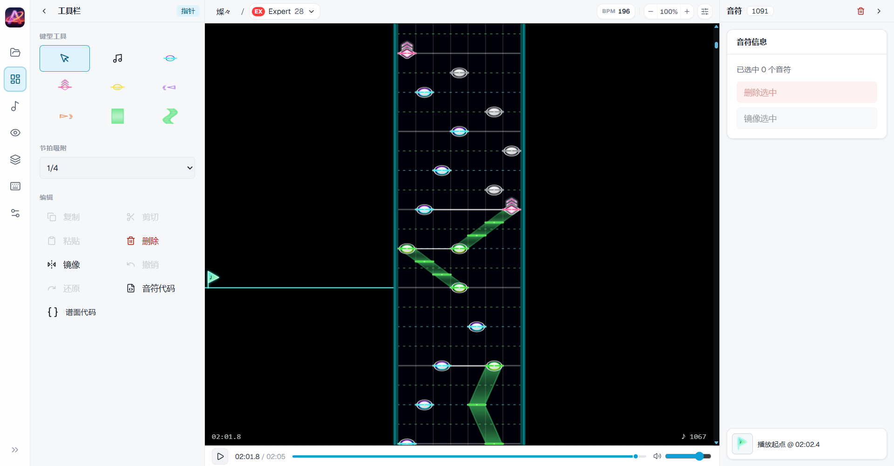

**放置滑条**

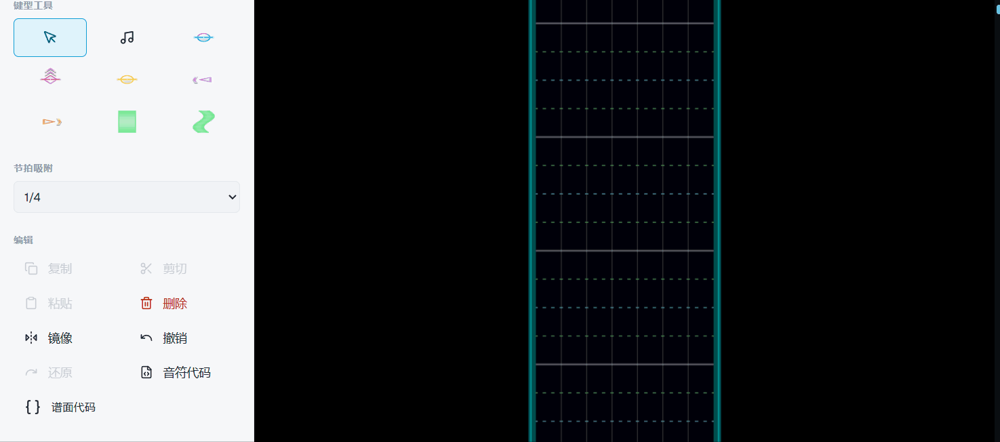

**SP 曲线与画笔**

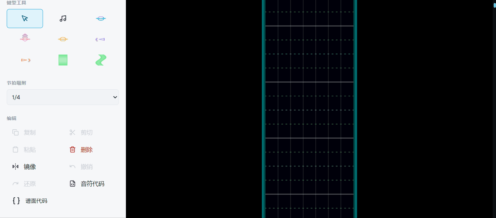

**拖动编辑**

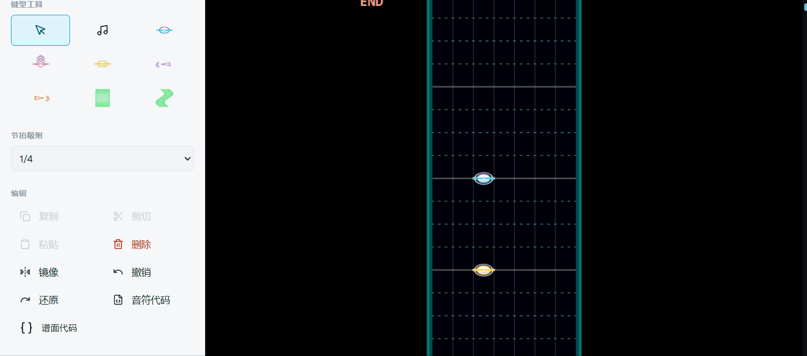

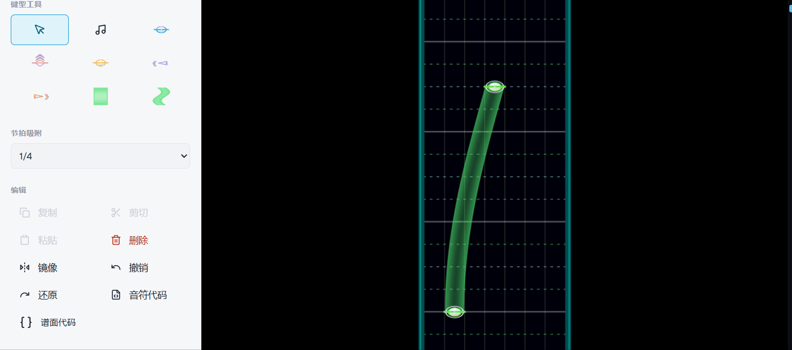

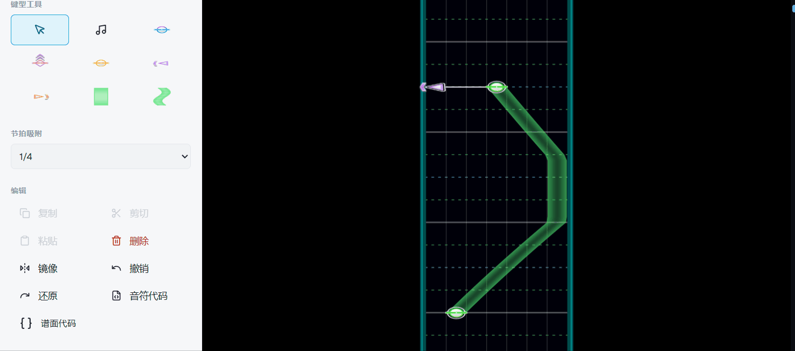

### 谱面预览与谱面图

- **静态预览**：整首谱面竖切成面板、横向排开、懒绘制；缩放 30%–300% 连续可调。
- **标注档**：BPM 标记 / 时间标记 / 节拍线 / Combo 标记 / 镜向，按需开关。
- **一键导出谱面图**：带头带（封面 + 难度 + BPM + 时长 + 音符数等曲目信息）的长图，发社交平台直接可用。

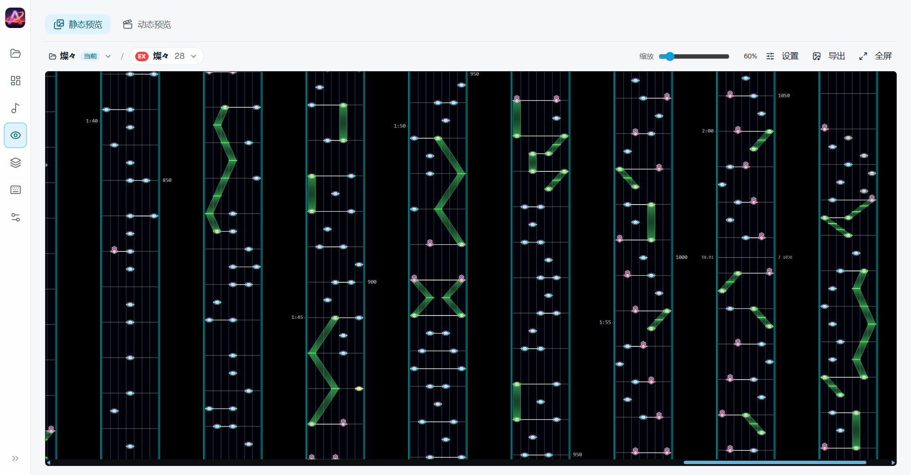

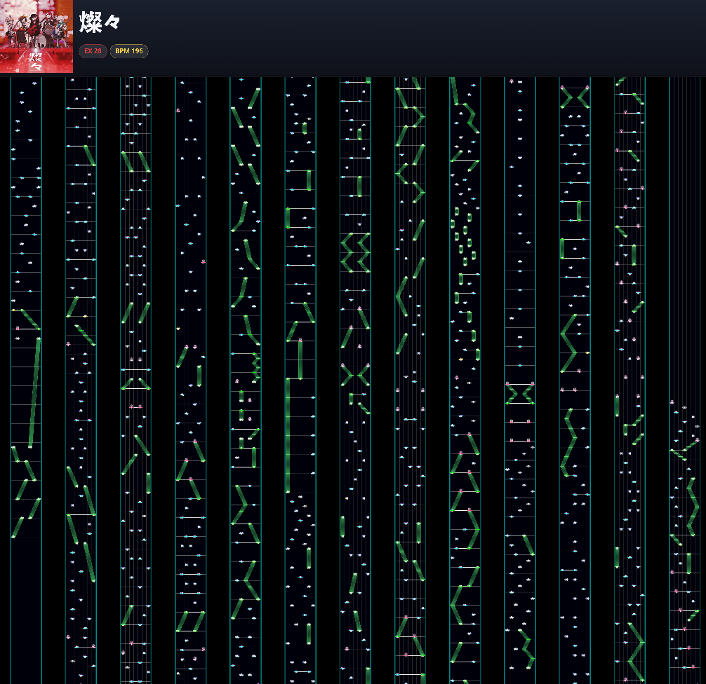

### Bestdori 社区互通

- 浏览**官方曲库**与**社区谱**：搜索、试听、按难度导入，音频与封面一并带入。
- 从官方谱面或社区帖直接创建工程，谱面代码原样落入编辑器。
- 账号授权后把谱面**发布**到社区；已发布的谱面只读，要改就复制副本再传。

> <!-- TODO(本地补拍): 选曲面板 / 账号授权与上传发布流程截图 -->

### 仿真场回放与视频导出

- **游戏式仿真场**：按接近模型缩放的音符、打击特效、combo 数字、连按双环；场地皮肤与表演背景可选。
- **实时回放**：倍速 0.25× – 2×；有音频放 BGM + 键音，无音频走合成时间线。
- **离线导出视频**：逐帧渲染 + WebCodecs 编码，MP4 / WebM、1080p / 720p、可选静音；视频开头自动缀一段 5 秒曲目信息片头（封面 + 难度 + 标题 + 乐队）。

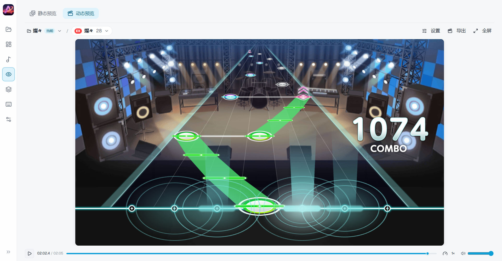

### 素材与个性化

- **音符皮肤**：整包预设一键写入，六类条目（单键 / 滑键 / 技能键 / 左右方向 / 滑条）可独立覆盖，实时综合预览。
- **键音素材包**整包切换；节奏图示音效独立音量。
- **画布背景皮肤**：本机图片，可调不透明度 / 填充方式 / 显示范围。
- **外观**：亮 / 暗主题、界面语言（简体中文 / English）、界面字体栈与字号（70%–150%）。

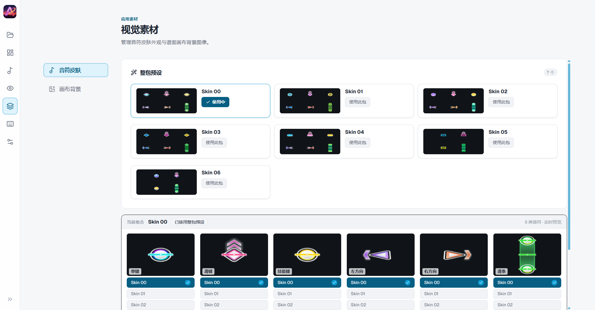

### 本地优先

- 谱面工程与设置保存在本机数据目录，不经过任何业务服务器。
- **无远程遥测**；排障依靠应用内导出的诊断包（版本 / 环境 / 日志 / 操作轨迹）。
- 设置对象可导入导出，换机迁移一个 JSON 文件。

## 非官方声明

AAO Editor 是一款非营利的粉丝自制工具，与 Bushiroad、Craft Egg 及 BanG Dream! 项目官方无任何关联，亦未获其背书。应用内的音符皮肤、键音等游戏素材版权归 © BanG Dream! Project 所有，本仓库的 [MIT](./LICENSE) 许可仅覆盖 AAO Editor 自身代码，不覆盖上述素材。如认为本仓库内容侵犯了您的权益，请通过 [GitHub Issues](https://github.com/wuqiongjin/AAO-Editor/issues) 联系我们处理。

## 本地开发

环境要求：Node.js ≥ 20.19 与 npm。

```bash
git clone https://github.com/wuqiongjin/AAO-Editor.git
cd AAO-Editor
npm install
npm run assets:sync   # 同步皮肤、键音、场地等运行时素材（需 CNB 访问凭据，向维护者索取）
bash scripts/dev.sh   # 启动开发服务器（统一处理文件描述符上限与对外地址）
```

> **仓库结构**：开发与 CI 在 [CNB 主仓](https://cnb.cool/AsterPicker/AAO-Editor)，GitHub 为发布镜像（安装包发布 + 代码自动同步）。Issues / PR 请直接提交到 GitHub 仓；PR 合并后由维护者回流 CNB——代码以 CNB 为准，直接推送到 GitHub 的提交进不了镜像（非快进会被拒绝）。GitHub 侧同样有门禁：`main` 只接受能过 `gate` 检查的 PR 合入（CNB 镜像账号除外），`v*` tag 仅授权身份可创建；fork 来的 PR 取不到私有素材，需维护者把分支推入本仓后重跑门禁。

常用命令：`npm test`（单元测试 + 静态锁测）、`npm run build`（Web 构建）、`npm run electron:dev` / `npm run electron:build`（桌面端开发 / 打包）。

## 文档

- 领域术语与规则：[`CONTEXT.md`](./CONTEXT.md)；架构决策记录：[`docs/adr/`](./docs/adr/)
- 产品使用文档站：`<占位：docs-site 上线后回填>`
- 问题反馈：[GitHub Issues](https://github.com/wuqiongjin/AAO-Editor/issues)

## 许可证

本仓库代码以 [MIT](./LICENSE) 许可发布，Copyright © 2026 AAO Editor。

MIT 许可仅覆盖 AAO Editor 自身代码；应用内游戏素材的版权归属见上方「非官方声明」。
