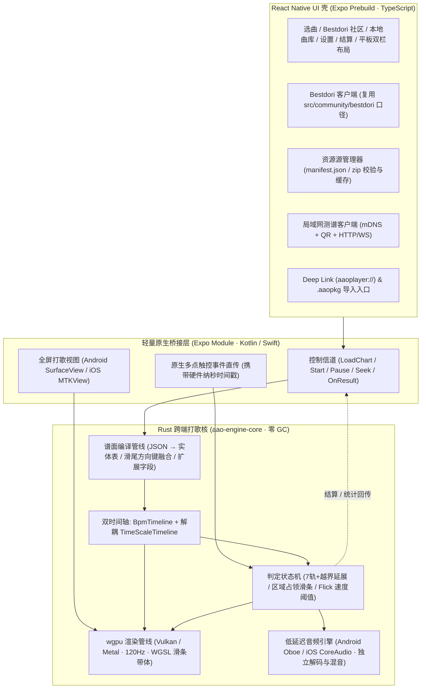

# AAO Player 技术调研、资产复用清单与起步蓝图（2026-11-26）

> 本文为调研与工程起步参考文档（非决策）；已拍板的架构与生态边界以 [ADR-0025](../adr/0025-伴生移动端模拟器AAO-Player架构与生态边界.md) 及 [CONTEXT.md](../../CONTEXT.md) 为准。
> 目标独立仓库：`AAO-Player`

---

## 1. AAO Editor 可复用资产与代码盘点

### 1.1 资产层（经 `assets-sync` 外部快照仓导出为外部「资源源」）

AAO Player 安装包本身**零内置版权素材**（自带一套 AAO 原创基础包），但可通过导出脚本把 AAO Editor 外部快照仓一键打包成标准 `manifest.json` 资源源，供开发调试与用户自行配置：

| 资产类别 | AAO Editor 现有路径 | 复用情况与补齐项 |
| --- | --- | --- |
| 音符与方向键皮肤 | `public/assets/skins/skin00..06/`、`directionalflickskin00..04/` + `src/rendering/skin/gen/noteSkinRegistry.gen.ts` | 直接复用切图坐标表与精灵；含 `longNoteLine` / `longNoteLine2` / `simultaneous_line` |
| 场地与表演背景 | `public/assets/sim/fieldskin/`、`bgskin/` + `src/preview/video/sim/gen/simAssetPacks.gen.ts` | 直接复用；原创「AAO 舞台」(`public/assets/preview/aao-stage-frame-bg.webp`) 可直接作为内置原创默认舞台 |
| 特效与数字精灵 | `public/assets/sim/sprites/jp/{combo,digits,particles}.png` | 直接复用连击数字与打击粒子 |
| 判定字与 HUD | `public/assets/game-ui/` | 现有只裁了 `PERFECT` / `AUTO`；**需补裁** `GREAT / GOOD / BAD / MISS / FAST / SLOW` |
| 键音素材包 | `src/assets/audio/keysounds/` + `src/audio/gen/` | 现有 5 类基础键音可直接转资源源；**需补齐**长条按住循环音、空点/MISS 音效（或自制） |

### 1.2 代码与算法层（TypeScript 复用 vs Rust 重写）

| 能力域 | AAO Editor 现有模块 | 在 AAO Player 中的去向 |
| --- | --- | --- |
| Bestdori 社区协议（曲库/帖子/资产 URL/限流） | `src/community/bestdori/`、`src/community/assetUrls.ts`、`src/community/transport.ts` | **RN (TS) 层直接复用**：替换 `transport.ts` 为移动端原生 `fetch`（无浏览器 CORS 限制），复用率 >85% |
| 谱面数据解析与校验口径 | `src/chart/editing/ChartConverter.ts`、`SlideSegments.ts`、`src/audio/AudioTiming.ts` | **逻辑下沉 Rust 核重写 + 复用同源单测语料**：作为编译管线参考真值，保证非单调点序、SP 段、倒流区、负 beat、同刻键音归并口径与编辑器逐字节一致 |
| 场地几何与接近公式 | `src/preview/video/sim/simGeometry.ts`、`simBandGpu.ts`、`simHud.ts` | **算法移植到 Rust + `wgpu`**：`1334×750` 基准几何、`sonolus-bandori-engine` 分段接近公式、WebGL2 滑条带体抗锯齿着色器逻辑可直接改写为 WGSL |
| 实时回放引擎 | `src/audio/AudioEngine.ts`、`simPlayback.ts` | **不复用**（Web Audio 在 Android 延迟过高）：在 Rust 核用 `Oboe`(Android) / `CoreAudio`(iOS) 重建低延迟实时音频混音器 |
| 多点触控与判定状态机 | 无（编辑器仿真场为只读） | **Rust 核全新构建** |

---

## 2. 总体混合架构（React Native + Rust Core）

核心设计红线：**打歌热路径（触控采集 → 判定 → 键音触发 → 120Hz 渲染）全程驻留 Rust 原生线程，严禁穿过 React Native JS 线程，彻底消除 JS 桥接延迟与 GC 卡顿。**



### 为什么选 `wgpu` + `Oboe`/`CoreAudio`？
- **渲染（`wgpu`）**：统一 WGSL 着色器，Android 底层自动走 Vulkan（老机回退 GLES3），iOS 底层原生走 Metal；可将 AAO Editor `src/preview/video/sim/simBandGpu.ts` 的带体抗锯齿积分着色器几乎 1:1 翻译为 WGSL，同时具备编译至 WebGPU/WASM 反哺编辑器的潜力。
- **音频（`Oboe` + `CoreAudio`）**：
  - Android 走 Google 官方 `Oboe`（优先 AAudio 独占低延迟流，旧机型回退 OpenSL ES），配合高优先级音频回调线程直接混音 BGM + 预解码 PCM 键音缓冲，延迟可压至 15–25ms。
  - iOS 走 `AVAudioEngine` / `AudioUnit` (CoreAudio)，配置 `AVAudioSession` 低缓冲时长（~5ms 级别）。
  - **时钟源**：以音频硬件已输出采样帧数（加系统输出延迟补偿与用户校准偏移）作为打歌主时钟，彻底避免音频与画面漂移。
- **触控（原生直通）**：Android `onTouchEvent`（含 `MotionEvent.getHistorical*` 高刷历史触控点）与 iOS `touchesBegan/Moved/Ended` 直接经 C ABI 传入 Rust，不走 RN 手势系统，完整保留 120Hz/240Hz 触控采样率。

---

## 3. 关键跨端协议草案（起步参考）

### 3.1 资源源清单（`manifest.json`）

```json
{
  "schemaVersion": 1,
  "id": "example-pack-source",
  "name": "Example Resource Source",
  "updatedAt": "2026-11-26T00:00:00Z",
  "packs": {
    "noteSkins": [
      { "id": "skin00", "name": "Skin 00", "url": "skins/skin00.zip", "sha256": "...", "bytes": 128000 }
    ],
    "fieldSkins": [],
    "backgrounds": [],
    "judgeSkins": [],
    "effectSkins": [],
    "keySounds": []
  }
}
```
- 模拟器内置原创默认包作为所有分类的兜底；某资源源缺某分类时逐项回退默认包，不阻断游玩。
- 同步在 AAO Editor 工具链补充导出脚本，将 `assets-sync` 本地快照打包为上述目录结构，开发期起一个静态文件服务即可联调。

### 3.2 局域网测谱协议（AAO Editor → AAO Player）

1. **发现与配对**：
   - 编辑器开启局域网服务（随机空闲端口 + 一次性会话 Token），广播 mDNS（`_aao-test._tcp.local.`）并展示配对二维码 `aaoplayer://lan?host=192.168.x.x&port=xxxx&token=xxx`。
2. **增量推送与音频去重**：
   - `GET /v1/session`：握手确认版本、能力集与当前工程元数据。
   - `POST /v1/push`（或 WebSocket `push_chart` 消息）：携带 `{ projectId, chartId, chartJson, audioSha256, audioUrl, coverSha256, coverUrl, startSeconds?, playbackRate?, invincible? }`。
   - 手机端先按 `audioSha256` 查本地缓存，**命中则跳过下载直接秒开打歌**；未命中再经 `GET /v1/blob/{sha256}` 拉取音频。
3. **V2 预留**：同一 WebSocket 预留手机→电脑上行通道（`play_report` / `mark_timestamp`），未来可把实机判定分布或标记点直接投射回 AAO Editor 画布。

### 3.3 本地包与移动端 Deep Link（服务未来 AAO Editor 移动端）

- URL Scheme：`aaoplayer://play?package=<fileUri>&start=<sec>&returnUrl=<scheme>`、`aaoplayer://lan?...`、`aaoplayer://source?url=<manifestUrl>`。
- 本地谱面交换包 `.aaopkg`（标准 ZIP）：
  - `meta.json`（标题、歌手、谱师署名、难度、等级、谱面时长、规则版本）
  - `chart.json`（原始 Bestdori / AAO 扩展谱面 JSON）
  - `audio.<mp3|ogg|wav>`（可选）
  - `cover.<png|jpg|webp>`（可选）

---

## 4. 谱面编译管线与扩展规则预留

```text
Raw Bestdori JSON
  │
  ├─► Pass 1: Normalize & Sanitize View
  │     (非单调滑条按 beat 稳定排序、掐首尾 hidden、识别负 beat 击打物)
  │
  ├─► Pass 2: Dual Timeline Build
  │     ├─► BpmTimeline       (beat ↔ realSeconds，含 ADR-0010 倒流区)
  │     └─► TimeScaleTimeline (realSeconds → visualDistance，默认恒定 1.0×；
  │                            未来读取 BPM/控制音符上的 AAO 自定义字段生成变速与 0 速时停曲线)
  │
  ├─► Pass 3: Composite Note Fusion
  │     (如检测 Slide 尾端点与同 beat/lane 的 Directional 融合为复合滑尾方向键)
  │
  └─► CompiledPlayChart (按到达时间排序的只读不可变结构，供判定器与渲染器零分配读取)
```

> **Bestdori 社区兼容提醒**：在正式设计任意自定义字段（例如挂在 `BPM` 音符上的变速/时停字段）之前，须先按本仓库 `docs/research/bestdori-community-upload.md` 的方法对 `POST /api/post` 与回读 `GET /api/post/details` 做真实字段保真测试，确认服务端不会过滤或拒收该字段名与值类型。

---

## 5. 新仓库（`AAO-Player`）建议目录与 V1 里程碑

### 5.1 建议仓库结构

```text
AAO-Player/
├── .github/workflows/          # Android APK 与 macOS 无证书未签名 IPA 构建流水线
├── CONTEXT.md                  # AAO Player 自身领域术语表（与 AAO Editor 保持同步）
├── docs/adr/                   # 模拟器内部实现期 ADR
├── .scratch/basic-player/      # V1 规格、索引与任务票
├── app/                        # Expo Router (React Native TypeScript UI 壳，全应用横屏，手机/平板双栏)
├── packages/
│   └── community-bestdori/     # 复用自 AAO Editor 的 Bestdori 协议与数据映射层
├── modules/
│   └── aao-engine-bridge/      # Expo Native Module (Kotlin SurfaceView + Swift MTKView + C ABI 桥)
├── engine/                     # Rust Workspace (独立于 RN，可纯桌面单测与压测)
│   ├── aao-chart/              # 谱面解析、编译管线、双时间轴（纯 Rust，可编译 WASM）
│   ├── aao-judge/              # 判定状态机、滑条区域占领、复合规则判定
│   ├── aao-audio/              # Oboe / CoreAudio 封装与低延迟混音器
│   └── aao-render/             # wgpu 渲染管线、WGSL 带体/精灵/特效/HUD、平板适配投影
└── assets-default/             # AAO 原创无版权默认皮肤与基础键音
```

### 5.2 V1 推荐推进顺序（先验证最高风险点）

1. **M0 — 最小打歌垂直切片（先攻克最难的 RN + Rust 桥接与延迟）**
   - 搭好 Expo Prebuild + Rust `wgpu` 全屏原生视图（Android APK + iOS 未签名 IPA CI 流水线跑通）；
   - 接通 `Oboe`/`CoreAudio` 低延迟键音 + 原生多点触控直传；
   - 用原创默认皮肤在真机（含平板）跑通一张本地 JSON 谱面的完整 7 轨打歌与 120Hz 稳帧压测。
2. **M1 — 完整判定、校准与练习闭环**
   - 对齐 `sonolus-bandori-engine` 判定窗口、SP 绿条追踪、倒流/越界轨处理、偏移校准页、轨宽/判定线调节、倍速/指定起播/无敌开关、本地成绩与 FAST/SLOW 统计。
3. **M2 — 资源源与 Bestdori 曲库**
   - 落地 `manifest.json` / `.zip` 资源源加载与缓存（并补齐 AAO Editor 快照导出脚本）；
   - 接入 Bestdori 官方谱 + 社区谱浏览与本地离线缓存曲库。
4. **M3 — 局域网测谱与包体入口**
   - 双端打通 AAO Editor ↔ AAO Player 局域网热推（QR/mDNS + 音频哈希缓存 + 标记点起播）；
   - 落地 `aaoplayer://` Deep Link 与 `.aaopkg` 本地包导入。
