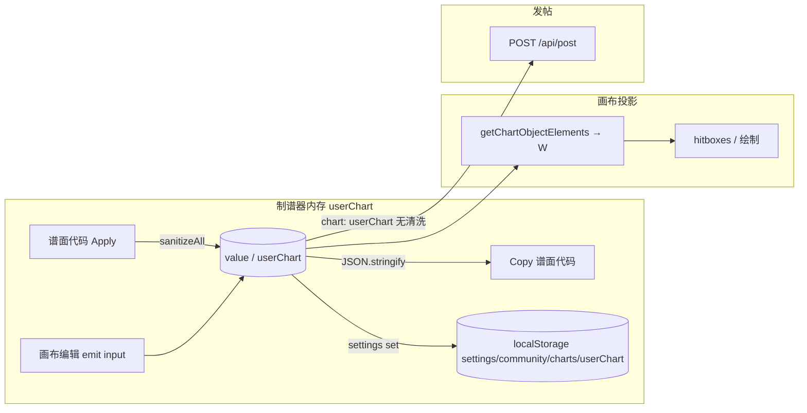

# Bestdori 官网制谱器谱面读写口径（2026-09-24）

> 对应 issue 155。只记官网前端事实，不做 ADR 决策。发帖清洗见 [bestdori-community-upload.md](./bestdori-community-upload.md)；只读 API 见 [bestdori-api.md](./bestdori-api.md)。

## 1. 结论摘要

| 问题 | 结论 |
| --- | --- |
| Mystery / 无 `type` 何时消失？ | **谱面代码整表 Apply 的当下**：`onConfirmEditCode` → `sanitizeAll`，按 `type` 白名单过滤，未知或缺 `type` 的对象**不会进入** `userChart` / 内存。关页再开只是 `localStorage` 读回同一数组，**不会二次过滤**。 |
| 已知 `type` 多余键何时保留？ | **Apply 后一直保留**（含 Copy、关开）。`sanitize` 只 `delete charge`，不剥其它键；connection 上的非 `charge` 多余键同样保留。 |
| `charge` | **仅 Apply（整表或单 note 代码）** 走 `sanitize` 递归删除；与 `sanitizeAll` 的类型过滤独立。 |
| 画布能否点到？ | 仅 `function W` 处理的五种 `type` 会生成 `hitboxes`；未知/无 `type` 若在内存中（理论上不应出现于 Apply 之后）**不可点**。 |
| 与发帖 `sanitizeAll` 是否同一函数？ | **是同一套逻辑**（`sanitize` + `sanitizeAll` 方法），但 **调用点不同**：制谱器 Apply 写内存；发帖 `onPublish` 直接提交当前 `userChart`，**不再调用** `sanitizeAll`。若内存里仍有 `System`/`charge`，会原样 POST（并可能 `POST_INVALID`）。 |
| 官方 API 贴入再 Copy | Apply 后相对 API：**丢全部 `System`（4 条 on 413 SP）**、**剥 30 处 `charge`**；`Long` 等白名单类型与字段结构保留；**无额外顶层键丢失**（413 SP 对照）。 |

**产品定案（156 grill，2026-09-24）**：我们 **Apply 硬拒**顶层未知/无 `type`（不学官网静默丢）；`System`/`charge` 在编辑器保真；**Bestdori 上传**自动 `sanitizeAll`，不因 System/charge 对用户报错。见 [ADR-0014](../adr/0014-宽松谱面代码源数据与画布投影.md) 与 [156 票](../../.scratch/basic-editor/issues/156-Apply闸门与Bestdori上传清洗定案.md)。

---

## 2. Bundle 钉 hash（2026-09-24）

从 `https://bestdori.com/community/charts/new` HTML 解析：

| 文件 | SHA256 前缀 | 用途 |
| --- | --- | --- |
| `CommunityChartsNew.b534f9a9.js` | `face219f2ca5…7394e4` | 制谱页 + `my-song-chart-editor` + `sanitizeAll` |
| `app.d390adb1.js` | `ac84605d7889…610778` | 路由、`settings` → `localStorage` |

与 2026-09-12 / [bestdori-api.md](./bestdori-api.md) §9 记录 **同一 `app` / `CommunityChartsNew` hash**。

复算 hash：

```bash
curl -sL 'https://bestdori.com/community/charts/new' | grep -oE 'CommunityChartsNew\.[a-f0-9]+\.js|app\.[a-f0-9]+\.js' | sort -u
sha256sum .cache/bestdori-bundles/CommunityChartsNew.b534f9a9.js .cache/bestdori-bundles/app.d390adb1.js
```

hash 变更时必须重下 bundle 并重跑 `scripts/replay-bestdori-chart-editor-io.mjs`。

---

## 3. 三条管道（读写 / 画布 / 发帖）



| 管道 | 入口 | 是否 `sanitizeAll` | 持久化 |
| --- | --- | --- | --- |
| **读入内存** | 谱面代码弹窗 Confirm | **整表：是**；单 note 代码：仅 `sanitize` | 写入 `userChart` 后立即 `localStorage` |
| **写出 Copy** | `onOpenEditCodeChart` | **否**（对当前 `value` 做 `JSON.stringify`） | — |
| **关页再开** | `settings` store `load` | **否** | `localStorage` key `settings/community/charts/userChart` |
| **预览 Tab 模拟器** | `repairedChart` 计算属性 | **否**（另一套 `r()` 修形，仅预览） | 不改 `userChart` |
| **发帖** | `onPublish` | **否** | 成功后会清空 `userChart` 等字段 |

---

## 4. 调用链与源码锚点

均在 **`CommunityChartsNew.b534f9a9.js`**（单行 bundle，下列为字符串搜索锚点）。

### 4.1 页面与状态

- 路由：`name:"community-charts-new"` → `/community/charts/new`（`app.d390adb1.js` 懒加载 chunk `CommunityChartsNew`）。
- 谱面 Tab：`my-song-chart-editor` `v-model` → `userChart`。
- `userChart` 等字段：`Object(u["a"])({ userChart: { name:"community/charts/userChart", defvalue:[], type:"array" }, … })` — 与 `app.d390adb1.js` 内 `settings` 模块的 `actions.set` → `localStorage.setItem("settings/"+name, JSON.stringify(data))` 联动。

### 4.2 谱面代码 Apply / Copy

组件：**`my-song-chart-editor`**（含 canvas、`modalEditCode`）。

| 方法 | 行为 |
| --- | --- |
| `onOpenEditCodeChart` | `codeHitbox=null`；`codeJson=JSON.stringify(this.value)`；打开弹窗 |
| `onConfirmEditCode` | `codeHitbox` 有值：局部替换 + `sanitize(JSON.parse(codeJson))`；否则 **`$emit("input", sanitizeAll(JSON.parse(codeJson)))`** |
| `sanitize` | `delete e.charge`；`connections.map(sanitize)` |
| `sanitizeAll` | `filter`：`type ∈ {Single, Directional, Slide, Long, BPM}`；再 `map(sanitize)` |

锚点字符串（便于 `rg`）：`onConfirmEditCode:function`, `sanitizeAll:function`, `onOpenEditCodeChart:function`.

### 4.3 画布投影

- `elements` 计算属性：`value.forEach` → `getChartObjectElements` → **`function W(e,t,i)`**。
- `W` 的 `switch(e.type)` 仅处理 `Single` / `Directional` / `Slide` / `Long` / `BPM`；**无 `default` 分支** → 未知类型返回空 `hitboxes`。
- 时间轴工具 `function K` 在裁切节拍时 **单独处理 `System`**（说明官方谱系对象在部分编辑工具里被认知），但 **`System` 不在 `sanitizeAll` 白名单**，无法通过整表 Apply 进入内存。

### 4.4 发帖

同 bundle 内 `onPublish`：`chart:this.userChart`（**无** `sanitizeAll`）。与 [bestdori-community-upload.md](./bestdori-community-upload.md) §4 一致。

---

## 5. Fixture 重放（Node）

脚本：`scripts/replay-bestdori-chart-editor-io.mjs`（逻辑与 bundle 内 `sanitize` / `sanitizeAll` 一致）。

| Fixture | Apply 后条数 | Copy ≡ Apply | 关开 ≡ Apply | 画布可点（任一对象） |
| --- | ---: | --- | --- | --- |
| `known-extra-top`（Single + `__extra`） | 2 | 是 | 是 | 是 |
| `connection-extra`（connection `tailTag`） | 2 | 是 | 是 | 是 |
| `unknown-type-mystery` | 2（Mystery 丢） | 是 | 是 | 是（剩余 Single） |
| `no-type-object` | 2（无 type 丢） | 是 | 是 | 是 |
| `sandwich-unknown` | 3（Weird 丢） | 是 | 是 | 是 |
| `charge-stripped` | 3（`charge` 剥） | 是 | 是 | 是 |

运行：

```bash
node scripts/replay-bestdori-chart-editor-io.mjs
node scripts/replay-bestdori-chart-editor-io.mjs --official-413
```

### 5.1 官方 `413_SP` 最小对照（`docs/resource/StressTestChart/Official/413_SP.json`）

| 指标 | API | Apply 后 |
| --- | ---: | ---: |
| 对象数 | 869 | 865 |
| `System` | 4 | 0 |
| 含 `charge` 键 | 30 | 0 |
| `Long` | 18 | 18 |

Apply 后 Copy / 持久化与上表一致（脚本：`copyMatchesApply` / `persistMatchesApply` 恒真）。

---

## 6. 研究问题逐条回答

1. **读写走哪段前端？** 制谱 Tab → `my-song-chart-editor`（`value`/`input`）；元数据与 `userChart` 数组 → `community-charts-new` 页 + `settings`/`localStorage`。`sanitizeAll` **仅**在编辑器 `onConfirmEditCode`（整表）出现；发帖 **不**调用。
2. **未知/缺 type / 多余键 / connection 多余键？** 未知与缺 `type`：**Apply 时丢**；多余键（非 `charge`）：**Apply 后保留**；`charge`：**Apply 时丢**；持久化不再丢。
3. **画布看不到是否仍在 Copy 里？** Apply 之后：未知对象已不在数组，Copy 不会包含。若内存中仍有未知对象（未经过整表 Apply 的路径，正常 UI 几乎不会产生），Copy **会** `JSON.stringify` 全数组，但画布仍无 hitbox。
4. **官方 API 贴入再 Copy？** 见 §5.1；**不**改变 153/ADR「官方 API 保真」产品口径（我们编辑器不跑 `sanitizeAll`）。

---

## 7. 与 `sanitizeAll`（发帖文档）的差异

| 维度 | 制谱器 Apply | 发帖 |
| --- | --- | --- |
| 函数体 | 相同 `sanitizeAll` | 期望数组**已**满足同一规则 |
| 是否自动调用 | Apply 时调用 | **不**调用，信任 `userChart` |
| 失败模式 | 静默丢对象 | `POST_INVALID`（若仍含 `System`/`charge`） |

上传实现仍应在客户端 **显式** `sanitizeAll`（见 ADR-0011 / issue 04），不能假设用户一定点过 Apply。
